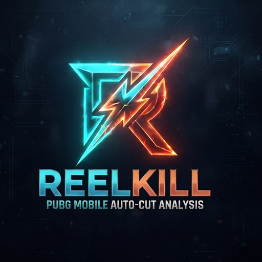

  

# REELKILL v2.0

**REELKILL** adalah aplikasi desktop berbasis C++ Native yang dirancang untuk mengotomatisasi proses *highlighting* video game PUBG Mobile. Aplikasi ini menggunakan kecerdasan buatan (OCR) untuk mendeteksi momen penting (seperti Kill Feed) dan memotong klip secara otomatis tanpa mengurangi kualitas video.

Dibuat untuk performa maksimal dengan penggunaan resource yang minim.

---

## Fitur Utama

- **Motion / Pixel Difference Filter**: Filter perubahan pixel ROI sebelum memanggil PaddleOCR. Mengabaikan frame statis sehingga kecepatan scanning video meningkat drastis (hingga 10x - 20x lebih cepat).
- **OCR Frame Analysis**: Deteksi nama pemain pada kill feed video rekaman secara otomatis.

### 2. Editor "LossCut" yang Interaktif
Fitur player bawaan yang memungkinkan Anda meninjau hasil scan.
* **Timeline Interaktif:** Geser (scrub) timeline dengan mulus untuk melihat momen yang terdeteksi (ditandai dengan marker kuning).
* **Export Cepat:** Ekspor momen hanya dalam hitungan detik menggunakan teknik *Lossless Cut* (tanpa render ulang).

### 3. Performa Tinggi & Stabil
* **Native Win32 API:** Antarmuka (UI) dibangun dari nol tanpa framework berat, menghasilkan aplikasi yang sangat ringan.
* **Anti-Glitch:** Manajemen memori dan *rendering* grafis yang dioptimalkan untuk pengalaman pengguna yang mulus (bebas flickering/ghosting).
* **Multi-resolution ROI Scaling:** Presets area deteksi otomatis menyesuaikan resolusi video secara proporsional.

---

## Teknologi yang Digunakan

* **Core:** C++ (Visual Studio)
* **UI:** Win32 API (Custom Dark Theme)
* **Vision:** OpenCV & OcrLite
* **Media:** libmpv & FFmpeg

---

## Cara Menggunakan

1. Download file Installer dari menu **Releases** atau jalankan installer hasil build.
2. Install aplikasi di PC Anda.
3. Buka **Dashboard**, pilih video game Anda, dan atur area deteksi (ROI).
4. Sesuaikan **Similarity Threshold** (Sensitivitas deteksi nama) sesuai kebutuhan.
5. Klik **Mulai Analisis**.
6. Setelah selesai, buka tab **Hasil Scan** untuk meninjau dan menyimpan klip Anda.

---

**Dibuat oleh [Ibra Farawowan]**
